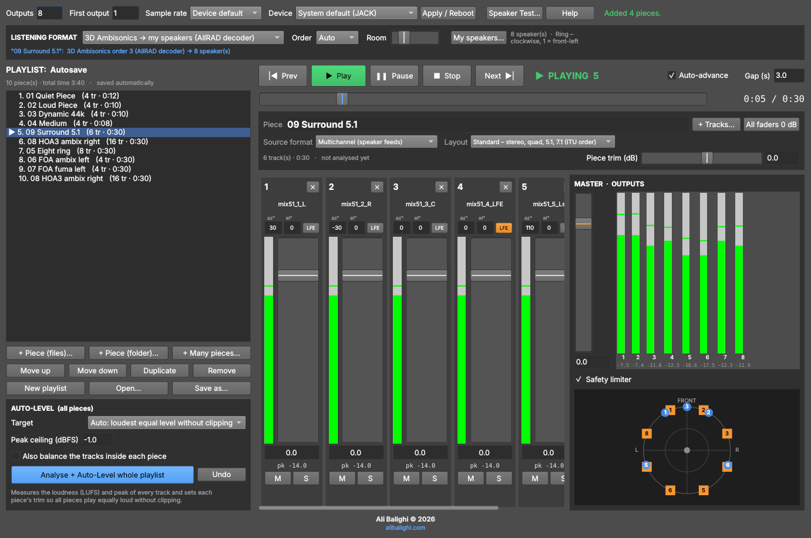

# Multichannel Player

**Version 0.1 Beta** · for SuperCollider · © 2026 Ali Balighi · [alibalighi.com](https://alibalighi.com)

A playlist player for multichannel music, written in SuperCollider. Each piece is a set of mono sound files (for example 4 files for a quadraphonic piece, or 8, 16 or 18 files). You can play a piece straight to your speakers, or turn it into 3D Ambisonics, VBAP panning, binaural sound for headphones, a stereo downmix, or Ambisonic B-format. Every volume you set is remembered. The player can also measure the loudness of the whole playlist and level all pieces for you.



---

## Contents

- [Features](#features)
- [Requirements](#requirements)
- [Installation and start](#installation-and-start)
- [Quick start](#quick-start)
- [The interface](#the-interface)
- [Source formats: what the files of a piece are](#source-formats-what-the-files-of-a-piece-are)
- [Listening formats: how you hear the pieces](#listening-formats-how-you-hear-the-pieces)
- [My speakers](#my-speakers)
- [Auto-level](#auto-level)
- [Speaker test](#speaker-test)
- [Keyboard and mouse](#keyboard-and-mouse)
- [Where your settings are stored](#where-your-settings-are-stored)
- [Scripting interface](#scripting-interface)
- [How it works](#how-it-works)
- [Troubleshooting](#troubleshooting)
- [Known limitations of this beta](#known-limitations-of-this-beta)
- [Version history](#version-history)
- [References](#references)
- [Author](#author)

---

## Features

- **Pieces made of mono files, any channel count.** One file per channel, with as many channels as the piece needs (2, 4, 8, 16, 18, 24, 36 …). Stereo or multichannel files are split into one track per channel.
- **Playlists.** Add one piece at a time, a folder per piece, or a whole folder of pieces in one go. Reorder, duplicate, rename, and save or open several playlists.
- **Transport.** Play, pause, stop, previous, next, a position bar you can drag, and auto-advance with an adjustable gap between pieces.
- **Mixer per piece.** Each track has a fader, number box, mute, solo, level meter and peak-hold display (red means clipping). Each piece also has a trim, and there is a master fader with output meters and a safety limiter.
- **Everything is remembered.** Faders, mutes, routing, positions, trims, master volume and all settings are saved automatically about one second after each change.
- **Listening formats.** Six formats are available:
  - direct multichannel (bit-exact)
  - 3D Ambisonics to your speakers (AllRAD, up to 5th order)
  - VBAP amplitude panning
  - binaural for headphones
  - stereo downmix
  - Ambisonic B-format out (AmbiX)
- **Ambisonic pieces.** AmbiX (ACN/SN3D) up to 5th order and FuMa up to 3rd order.
- **My speakers.** Describe your own speaker setup with a preset or your own angles, including subwoofers. A map shows your speakers and the tracks of the selected piece, seen from above.
- **Auto-level.** EBU R128 / ITU-R BS.1770 loudness analysis of every file, then a trim per piece so all pieces play equally loud without clipping. The analysis is cached, and Undo is available.
- **Speaker test.** Pink noise, band-limited pink noise for SPL calibration, white noise or a sine tone. Send it to one speaker, all speakers, or cycle through them, with level meters.
- **Any sample rate.** Files whose sample rate differs from the audio interface are resampled while playing.
- **Streams from disk,** so long pieces use very little memory.
- **No extensions needed.** It uses only core SuperCollider: no Quarks, no sc3-plugins.

---

## Requirements

- **SuperCollider 3.12 or newer** (developed and tested with 3.13). Download it from [supercollider.github.io](https://supercollider.github.io).
- macOS, Windows or Linux. On Linux, SuperCollider uses JACK.
- An audio interface with as many outputs as you want to use. Headphones or two speakers are enough for the binaural and stereo formats.

---

## Installation and start

1. Put `MultichannelPlayer.scd` anywhere on your computer.
2. Open it in the **SuperCollider IDE**.
3. Select everything (**Cmd+A** on macOS, **Ctrl+A** on Windows/Linux).
4. Press **Cmd+Return** (macOS) or **Ctrl+Return** (Windows/Linux).

The player window opens and the audio server starts by itself. To restart the player, run the file again: the old window is replaced and nothing is lost.

---

## Quick start

1. **Set up your outputs** in the top bar:
   - **Outputs:** the number of speakers, for example 4 for quad or 8 for octophony.
   - **First output:** the first output of your interface to use (usually 1).
   - **Sample rate** and **Device.**
   - Press **Apply / Reboot**. These settings are remembered.
2. **Check your speakers:** **Speaker Test…** → **Cycle through speakers**.
3. **Add pieces:**
   - **+ Piece (files)…** – select the mono files of *one* piece. Hold Cmd/Ctrl or Shift to select several.
   - **+ Piece (folder)…** – a folder that contains the files of one piece.
   - **+ Many pieces…** – a folder that contains one sub-folder per piece, for example 10 sub-folders = 10 pieces.

   Files are sorted by name, so `…_1, …_2, … _10` sort correctly. Track 1 goes to output 1, track 2 to output 2, and so on.
4. **Play:** double-click a piece, or press **Play** or the space bar.
5. **Set the volumes.** They are saved automatically.
6. **Optional:** press **Analyse + Auto-Level whole playlist** to make all pieces equally loud.
7. **Optional:** choose a **Listening format** if your speaker setup differs from the piece, or to listen on headphones.

---

## The interface

### Top bar

| Control | What it does |
|---|---|
| **Outputs** | Number of outputs (speakers) to use, 1–128. |
| **First output** | First hardware output (1 = the first output of the interface). |
| **Sample rate** | *Device default*, 44100, 48000, 88200 or 96000 Hz. |
| **Device** | Audio interface (macOS / Windows). On Linux, JACK is used. |
| **Apply / Reboot** | Restarts the audio server with these settings. |
| **Speaker Test…** | Opens the [speaker test](#speaker-test). |
| **Help** | A short guide inside the program. |
| Status | Messages, sample rate, outputs and CPU load. |

### Listening format bar

| Control | What it does |
|---|---|
| **Listening format** | How you hear the pieces – see [Listening formats](#listening-formats-how-you-hear-the-pieces). |
| **Order** | Ambisonic order: *Auto* or 1st–5th. Used by the Ambisonics and B-format formats. |
| **Room** | Binaural only: adds a little room reverberation so the sound seems outside your head. |
| **My speakers…** | Where your own speakers are – see [My speakers](#my-speakers). |
| Info line (blue) | What is happening to the selected or playing piece, e.g. *"3D Ambisonics order 3 (AllRAD decoder) → 8 speaker(s)"*. |

### Playlist (left)

- The list shows each piece's number, title, track count, duration and, after auto-level, its loudness. ▶ marks the piece that is playing, and ⚠ marks a missing file.
- **+ Piece (files)…**, **+ Piece (folder)…** and **+ Many pieces…** add pieces.
- **Move up**, **Move down**, **Duplicate** and **Remove** edit the list.
- **New playlist**, **Open…** and **Save as…** manage playlist files. Playlists are saved as `.mcplist` files and auto-saved all the time.

### Auto-level panel (bottom left)

This panel has the **Target** level, the **Peak ceiling**, **Also balance the tracks inside each piece**, **Analyse + Auto-Level whole playlist** and **Undo**. See [Auto-level](#auto-level).

### Transport

- **|◀ Prev:** goes to the previous piece. If the current piece has played for more than 3 seconds, it restarts the current piece instead.
- **▶ Play**, **❚❚ Pause**, **■ Stop** and **Next ▶|** work as usual.
- The state display shows PLAYING, PAUSED, STOPPED or "NEXT PIECE IN … s".
- **Auto-advance** starts the next piece after **Gap (s)** seconds (default 3 s).
- The **position bar** jumps to a point in the piece. Click it or drag it.

### Piece header

- **Piece title.** Click the title to rename the piece.
- **+ Tracks…** adds files to the selected piece.
- **All faders 0 dB** resets the track faders of the piece.
- **Source format** and **Layout** describe what the files of the piece are – see [Source formats](#source-formats-what-the-files-of-a-piece-are).
- An information line shows the number of tracks and duration. After analysis it also shows loudness and peak, before and after the trim.
- **Piece trim (dB)** is a volume for the whole piece, from −30 to +24 dB. Auto-level sets it. Double-click the slider to return to 0 dB.

### Track strips (mixer)

| Element | Meaning |
|---|---|
| Number and **✕** | Track number. ✕ removes the track from the piece. |
| File name | Hover over it to see the full path. Missing files are shown in red. |
| **→ out N** | *(Direct format)* the output this track goes to. |
| **az° / el° / LFE** | *(spatial formats, multichannel pieces)* direction of the track in degrees, and whether it is a subwoofer (LFE) channel. |
| **ACN n** | *(Ambisonic pieces)* which Ambisonic channel this file is. |
| Meter | Level of the track after its fader (before mute), −60 to 0 dBFS. |
| Fader and number box | Track volume, −60 dB (off) to +12 dB. Double-click the fader for 0 dB. |
| **pk** | Highest peak since the piece started. Red means clipping. Click it to reset. |
| **M / S** | Mute and Solo. |
| *file: … LUFS / peak* | After analysis: loudness and peak of the file itself. |

### Master (right)

- **Master fader** from −60 to +12 dB. Double-click it for 0 dB.
- **Output meters** with peak values. Click a value to reset it.
- **Safety limiter:** acts only if an output would go above −0.5 dBFS.
- **Map:** your speakers (squares; yellow = elevated) and the tracks of the selected piece (blue dots), seen from above with the front at the top. Click the map to edit your speakers.

### Footer

The footer shows *Ali Balighi © 2026* and *alibalighi.com*. Click the link to open the website.

---

## Source formats: what the files of a piece are

Every piece has its own **Source format**, set above the mixer.

### Multichannel (speaker feeds)

Each file is meant for one speaker. The **Layout** says where those speakers were meant to be. The direct format does not need this information, but every spatial format uses it.

Directions use **azimuth** (0° = front, +90° = left, −90° = right, 180° = back) and **elevation** (0° = ear height, +90° = straight up).

| Layout | Positions |
|---|---|
| **Ring – clockwise, 1 = front-left** | Equal spacing, clockwise seen from above, track 1 just left of front. 4 tracks: 45°, −45°, −135°, 135°. 8 tracks: 22.5°, −22.5°, −67.5° … |
| **Ring – clockwise, 1 = front centre** | Equal spacing, track 1 straight ahead, then clockwise. |
| **Pairs – 1 front-L, 2 front-R, 3 L, 4 R …** | Left/right pairs from front to back. 8 tracks: ±22.5°, ±67.5°, ±112.5°, ±157.5°. An odd last track goes to the back. |
| **Standard – stereo, quad, 5.1, 7.1 (ITU order)** | 2 = L R (±30°) · 3 = L R C · 4 = FL FR RL RR (±45°, ±135°) · 5 = L R C Ls Rs (±110°) · 6 = 5.1: L R C **LFE** Ls Rs · 7 = 7.0: L R C Lss Rss Lrs Rrs (±90°, ±150°) · 8 = 7.1: L R C **LFE** Lss Rss Lrs Rrs. Other counts use *Pairs*. |
| **Two rings – ear height + upper ring 35°** | Half of the tracks on a ring at 0°, the other half on a ring at +35°. 8 tracks = 4 + 4, 16 = 8 + 8. |
| **Dome – ring + upper ring + top** | One speaker straight up; about two thirds of the rest at ear height and one third at +40°. For example 13 = 8 + 4 + 1, 19 = 12 + 6 + 1. |
| **Sphere – evenly spread (3D)** | Tracks spread evenly over the whole sphere. |
| **Custom angles** | Type the azimuth and elevation of each track in its strip. Editing any angle switches the piece to *Custom*. |

Press **LFE** in a strip to mark a low-frequency channel. It is not placed in space; it goes to your subwoofer(s).

### Ambisonics AmbiX (ACN / SN3D)

The files are Ambisonic channels in **ACN order** with **SN3D** normalisation (the AmbiX convention):

| Files | Order |
|---|---|
| 4 | 1st |
| 9 | 2nd |
| 16 | 3rd |
| 25 | 4th |
| 36 | 5th |

### Ambisonics FuMa (W X Y Z …)

The files are in Furse-Malham order and weighting: W X Y Z (1st order), plus R S T U V (2nd) and K L M N O P Q (3rd). They are converted to AmbiX internally. Up to 3rd order (16 files) is supported.

### Automatic recognition

When you add a piece, the player guesses the format from the file names:

| File names contain | Number of files | Recognised as |
|---|---|---|
| `ambix`, `acn`, `foa`, `hoa` or `ambisonic` | a square number (4, 9, 16 …) | AmbiX |
| `fuma`, `bformat`, `b-format` or `wxyz` | 4, 9 or 16 | FuMa |
| `lfe` | any | Layout *Standard* |
| — | 2 files | Layout *Standard* (stereo) |
| anything else | any | Multichannel, layout *Ring – clockwise, 1 = front-left* |

You can always change the guess in the piece header.

---

## Listening formats: how you hear the pieces

The listening format is a single setting for the whole player, because it describes *your* playback system.

| Format | What happens | Outputs used |
|---|---|---|
| **Multichannel – direct** | Track N → output N, untouched and bit-exact. The **→ out** menu of a strip changes the output. Ambisonic pieces are sent out as raw Ambisonic channels. | 1 … number of tracks |
| **3D Ambisonics → my speakers** | Every track is encoded at its direction and decoded to *your* speakers. An 8-, 16- or 18-channel piece plays on 4, 5, 8 … speakers, and an Ambisonic piece is decoded to your setup. | all your speakers |
| **Amplitude panning (VBAP) → my speakers** | Every track is panned between the 2 or 3 nearest speakers. When a track's position matches one of your speakers it plays only from that speaker. | all your speakers |
| **Binaural → headphones** | Every track becomes a virtual sound source around your head. | 1–2 |
| **Stereo downmix → 2 speakers** | Constant-power downmix. Tracks at ±30° or wider go fully left or right; tracks behind you are folded to the front and slightly lowered. | 1–2 |
| **Ambisonics B-format out (AmbiX ACN/SN3D)** | Multichannel pieces are encoded to Ambisonics and Ambisonic pieces are passed through, for an external decoder or for recording. | 1 … (order+1)² |

### Details of the 3D Ambisonics format

**Horizontal layouts** (all speakers within ±10° of ear height, e.g. rings) use a 2D max-rE decoder of the horizontal components, followed by pairwise panning. **3D layouts** (domes, spheres, cubes) use an **AllRAD** decoder: a max-rE sampling decoder to 240 virtual speakers, followed by VBAP to your speakers.

**Order *Auto*** depends on your speakers, and is limited to 1st–5th and to the piece's own order:

| Your layout | Auto order | Examples |
|---|---|---|
| Horizontal ring of N speakers | (N − 1) ÷ 2 | 4 → 1st, 8 → 3rd |
| 3D layout of N speakers | √N − 1 | 9 → 2nd, 16 → 3rd |

You can force any order from 1st to 5th.

The decoders keep the overall level constant, so the loudness stays similar when you switch formats. LFE tracks go to the speakers you marked as *Subwoofer*, or are spread over all speakers if you have none.

### Details of the binaural format

The binaural format uses a **spherical-head model** (Brown & Duda) rather than measured head recordings:

- the time difference between the ears
- the shadow of the head
- a gentle cut of high frequencies for sources behind you

Ambisonic pieces are first decoded to 8–50 virtual speakers. The **Room** slider (default 20 %) adds reverberation to help the sound seem outside your head. LFE tracks go equally to both ears.

### Details of the B-format output

**Order *Auto*** = 3rd order, limited by the number of outputs: 4 outputs give 1st order, 9 give 2nd, 16 give 3rd. Channels are in ACN order with SN3D normalisation. LFE tracks go to W.

### Changing format during playback

Changing the format while a piece is playing is allowed. If only the gains change, the change is seamless. If the routing changes, the piece restarts at the same position.

---

## My speakers

Press **My speakers…** (or click the map) to describe *your* playback system. This is used by the **3D Ambisonics** and **VBAP** formats.

- **Preset:** the same layouts as for pieces (ring, pairs, standard, two rings, dome, sphere), sized to the number of **Outputs**.
- **Az / El** for every output, to describe your own setup exactly. Editing a value switches to *Custom angles*.
- **Subwoofer:** tick this for outputs that feed a subwoofer. Subwoofers are not used for placing sounds; they receive the LFE tracks.
- The map shows your speakers (squares; yellow = elevated) and the tracks of the selected piece (blue dots).

To change the *number* of speakers, change **Outputs** in the top bar and press **Apply / Reboot**.

---

## Auto-level

**Analyse + Auto-Level whole playlist** does the following:

1. **Measures every file offline**, many times faster than real time (in testing, a 10-minute file took less than a second). It uses an offline copy of the SuperCollider audio engine, three files at a time.
   - **Loudness:** integrated loudness in **LUFS** (ITU-R BS.1770 / EBU R128): K-weighting, 400 ms blocks with 75 % overlap, an absolute gate at −70 LUFS and a relative gate at −10 LU.
   - **Peak:** the highest sample peak.
2. **Calculates each piece's loudness** with your current track faders and mutes.
   - Multichannel pieces: the energy of all tracks is summed.
   - Ambisonic pieces: the loudness of the W channel is used.
3. **Estimates the output peaks** for the current listening format. In direct mode this is exact.
4. **Sets a trim for every piece** so they all reach the **Target**, without letting any piece go above the **Peak ceiling** (default −1 dBFS).

**Target options:**

| Target | Meaning |
|---|---|
| **Auto: loudest equal level without clipping** | The highest level that *every* piece can reach without passing the ceiling. Use the master fader for the room level. |
| **−16, −18, −20, −23 (EBU R128) or −27 LUFS** | Fixed levels. A piece that cannot reach the target without passing the ceiling is marked *"limited by peak ceiling"*. |

**Also balance the tracks inside each piece** (off by default) evens out the tracks of each multichannel piece by moving their faders, by at most ±9 dB. Leave it off when the balance between channels is part of the composition.

**Undo** restores the faders and trims from before the last auto-level.

The analysis is cached (see [Where your settings are stored](#where-your-settings-are-stored)), so running it again is almost instant. A file is analysed again only if it has changed.

If you change the listening format, run auto-level again. It is instant, and it updates the peak estimates.

---

## Speaker test

**Speaker Test…** opens a window with:

- **Signal:**
  - pink noise (full range)
  - pink noise 500 Hz–2 kHz (for SPL calibration)
  - white noise
  - a sine tone with an adjustable frequency
- **Level** in RMS dBFS, from −60 to −6 (default −20). All signals are normalised to that RMS level.
- **Speaker 1 … N** buttons (several can be on at once), **All speakers on**, **All off**, and **Cycle through speakers** with an adjustable time per speaker (default 2 s).
- **Output level meters**, with peak values.

The test signal passes through the master fader and the safety limiter, like the music.

A common calibration is band-limited pink noise at −20 dBFS RMS. Set every speaker to the same sound pressure level with an SPL meter, for example 79–85 dB C-weighted, slow.

---

## Keyboard and mouse

| Action | Result |
|---|---|
| **Space** | Play / pause. Not active while you type in a text field. |
| **Double-click a piece** or **Return** in the list | Play that piece from the beginning. |
| **Double-click** a track fader, the trim slider or the master fader | Back to 0 dB. |
| Click a **pk** value or an output peak value | Reset the peak hold. |
| Click the **map** | Open *My speakers*. |
| **Cmd+.** / **Ctrl+.** | Stop all sound (standard SuperCollider). The player rebuilds itself and can play again immediately. |

---

## Where your settings are stored

Everything is stored in the SuperCollider application-support folder, in a sub-folder called `MultichannelPlayer`:

| System | Folder |
|---|---|
| macOS | `~/Library/Application Support/SuperCollider/MultichannelPlayer` |
| Windows | `%LOCALAPPDATA%\SuperCollider\MultichannelPlayer` |
| Linux | `~/.local/share/SuperCollider/MultichannelPlayer` |

To see the exact path on your computer, run `Platform.userAppSupportDir` in SuperCollider, or open **Help** in the player.

| File | Contents |
|---|---|
| `prefs.scd` | Outputs, first output, device, sample rate, master volume, limiter, listening format, order, your speaker layout, room amount, speaker-test settings, and the last playlist. |
| `Autosave.mcplist` | The playlist used until you choose *Save as…*. |
| `*.mcplist` | Playlists: pieces, files, track faders, mute/solo, outputs, positions, source format, layout, trims, analysis results, auto-advance, gap and auto-level settings. |
| `analysis-cache/` | Loudness analysis of each file, which can be deleted at any time. |

Changes are saved about one second after you make them, and again when the window closes. The player reopens the last playlist automatically.

Sound files are stored by their full path. If you move them, the piece shows **⚠ missing file**; add them again with **+ Tracks…**. Playlist and preference files are plain SuperCollider text.

**Supported sound files:** WAV, BWF, RF64, W64, AIFF/AIFC, FLAC, CAF, OGG, AU/SND — whatever libsndfile can read. Any sample rate and bit depth can be used.

---

## Scripting interface

While the player is running, the environment variable `~multichannelPlayer` gives access from code. Indices start at **0**.

```supercollider
~multichannelPlayer[\addFolderOfPieces].("/path/to/my/pieces");  // one sub-folder per piece
~multichannelPlayer[\play].(0);            // play the first piece
~multichannelPlayer[\play].(2, 30);        // play the third piece from 30 s
~multichannelPlayer[\pause].();
~multichannelPlayer[\resume].();
~multichannelPlayer[\next].();
~multichannelPlayer[\stop].();

~multichannelPlayer[\setFormat].(1);       // 0 direct, 1 Ambisonics, 2 VBAP, 3 binaural, 4 stereo, 5 B-format
~multichannelPlayer[\setOrder].(3);        // 0 = Auto, 1–5
~multichannelPlayer[\setSpeakerPreset].(5);  // see the layout numbers below
~multichannelPlayer[\setSourceFormat].(0, \ambix);       // \multi, \ambix or \fuma
~multichannelPlayer[\setSourceFormat].(1, \multi, 2);    // multichannel, layout "Pairs"

~multichannelPlayer[\setTrackDb].(0, 2, -3.5);  // piece 0, track 2 → −3.5 dB
~multichannelPlayer[\setMasterDb].(-6);
~multichannelPlayer[\solo].(0, 1, true);        // solo track 1 of piece 0
~multichannelPlayer[\autoLevel].();

~multichannelPlayer[\state].();            // transport, current piece, position, peaks …
~multichannelPlayer[\render].(0).note;     // how piece 0 is rendered right now
```

Other entries:

| Entry | What it does |
|---|---|
| `select` | Select a piece. |
| `addPiece` | Add a piece from a list of paths (and an optional title). |
| `addFolder` | Add a folder as one piece. |
| `speakerTest` | Open the speaker test window. |
| `speakers` | Open the *My speakers* window. |
| `testOn` | Turn on the test signal for one output. |
| `testAllOff` | Turn off all test signals. |
| `testCycle` | Start (`true`) or stop (`false`) cycling through the speakers. |
| `pieces` | The playlist data. |
| `analysing` | Whether an analysis is running. |
| `math` | The spatial-audio functions. |
| `window` | The player window. |

**Layout numbers:** 0 ring from front-left · 1 ring from front · 2 pairs · 3 standard · 4 two rings · 5 dome · 6 sphere · 7 custom (pieces only).

---

## How it works

For those who want to know what happens inside.

- **Playback.**
  - Every track is streamed from disk with `DiskIn`, or with `VDiskIn` and resampling when its sample rate differs from the server's.
  - All tracks of a piece start in one timed OSC bundle, so they stay sample-synchronous.
  - Pause, stop and jumps use short fades to avoid clicks.
- **Routing.**
  - Each track synth multiplies its signal by a fixed vector of output gains.
  - All listening formats are computed once, in the language, as gain matrices. They cost almost no CPU on the server.
  - Binaural adds one renderer synth with a delay and two first-order filters per virtual source and per ear, plus a reverb.
- **Ambisonics.** Real spherical harmonics in ACN order with SN3D normalisation, up to 5th order; max-rE weighting; and an AllRAD decoder (or a 2D decoder for horizontal layouts), normalised for energy.
- **VBAP.** Pulkki's vector-base amplitude panning on the convex hull of your speakers. Imaginary speakers fill gaps in the layout (for example above a ring, or behind a stereo pair); their signal is discarded and the result normalised again.
- **Master.** Master gain, an optional look-ahead limiter at −0.5 dBFS, output metering, and the output to the hardware outputs.
- **Analysis.** An offline scsynth process per file writes the K-weighted mean square of every 100 ms, and the running peak, to a small file in the cache. The language then calculates the gated loudness.

---

## Troubleshooting

**The audio server does not start.**
- Check **Device** and **Sample rate**, then press **Apply / Reboot**.
- On macOS, choose a fixed sample rate that matches your interface (also check it in *Audio MIDI Setup*).
- On Linux, JACK must be running, or startable by SuperCollider.

**No sound.**
- Check **First output**, the **Master** fader, **Mute/Solo**, and that the chosen device is your interface.
- Use **Speaker Test…** to check each output.

**The speakers play in the wrong order.**
- In *Multichannel – direct*, use the **→ out** menu of each strip.
- In the spatial formats, choose the right **Layout** for the piece, and the right layout in **My speakers…**.

**"This piece has N tracks but only M outputs".**
- Either increase **Outputs**, or choose a listening format that fits any number of speakers: 3D Ambisonics, VBAP, binaural or stereo.

**Clipping (red pk or red output values).**
- Lower the trim or the master.
- Run **Auto-level**.
- Keep **Safety limiter** on.
- Downmix formats (stereo, binaural) can add the tracks together and go higher than the files themselves.

**Dropouts or clicks with many tracks.**
- Increase the hardware buffer size of your audio interface in the system settings.
- Use a fast disk, such as an SSD.

**"⚠ missing file".**
- The file was moved or renamed. Add it again with **+ Tracks…**, or remove the piece and add it again.

**The window is too big for the screen.** The window can be resized; the mixer and the output meters scroll.

---

## Known limitations of this beta

- Tested so far with SuperCollider 3.13 on Linux. Reports from macOS and Windows users are very welcome.
- Binaural rendering uses a generic head model. Personal or measured HRTFs (e.g. SOFA files) and head tracking are not supported yet.
- No speaker delay or level compensation for speakers at different distances. Calibrate the levels with the speaker test, and the delays in your interface or speaker controller.
- Peaks are sample peaks, not true peaks. Keep the peak ceiling at about −1 dBFS.
- Ambisonics up to 5th order (36 files), and FuMa up to 3rd order (16 files).
- VBAP needs speaker feeds; Ambisonic pieces are decoded with Ambisonics instead.
- Binaural and stereo always use outputs 1–2 (counted from **First output**).
- There are no crossfades between pieces; there is a gap instead.

---

## Version history

**0.1 Beta** — 29 October 2026. First public beta, with:
- playlists
- per-track and per-piece levels that are remembered
- speaker test
- auto-level (EBU R128)
- six listening formats: direct, 3D Ambisonics (AllRAD), VBAP, binaural, stereo, B-format
- AmbiX and FuMa sources
- speaker layout editor

---

## References

- ITU-R BS.1770, *Algorithms to measure audio programme loudness and true-peak audio level*; EBU R 128, *Loudness normalisation and permitted maximum level of audio signals*.
- V. Pulkki, "Virtual sound source positioning using vector base amplitude panning", *J. Audio Eng. Soc.* 45(6), 1997.
- F. Zotter and M. Frank, "All-Round Ambisonic Panning and Decoding", *J. Audio Eng. Soc.* 60(10), 2012.
- C. Nachbar, F. Zotter, E. Deleflie and A. Sontacchi, "AMBIX – A Suggested Ambisonics Format", Ambisonics Symposium, 2011.
- C. P. Brown and R. O. Duda, "A structural model for binaural sound synthesis", *IEEE Trans. Speech and Audio Processing* 6(5), 1998.
- SuperCollider: [supercollider.github.io](https://supercollider.github.io)

---

## Author

**Ali Balighi** © 2026 · [alibalighi.com](https://alibalighi.com)
